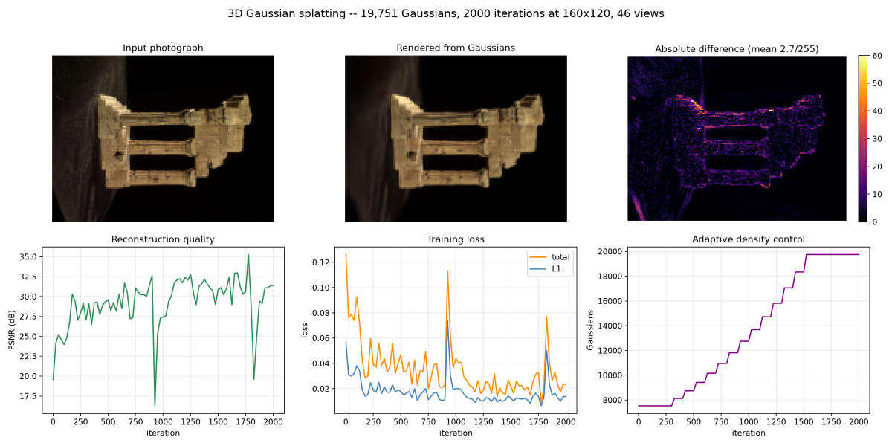
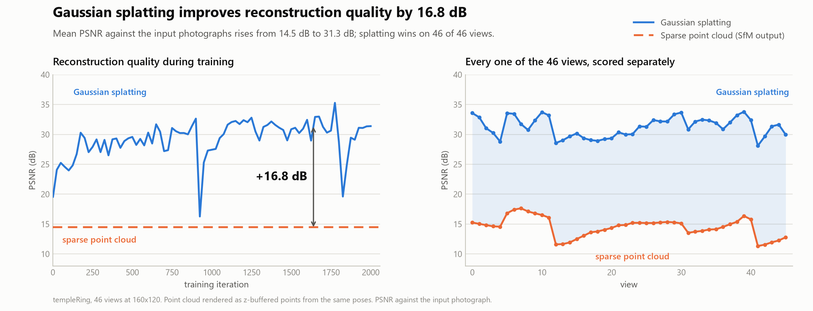
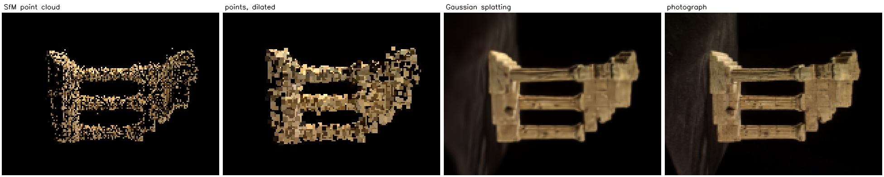

# 3D Gaussian Splatting

A from-scratch implementation of **3D Gaussian Splatting** (Kerbl, Kopanas,
Leimkühler & Drettakis, SIGGRAPH 2023), trained on the output of a
Structure-from-Motion reconstruction. PyTorch supplies the tensor maths and
the automatic differentiation; every stage of the method itself — the
parameterisation, the 3D→2D covariance projection, the tile rasteriser, the
alpha compositing, the loss and the adaptive density control — is written out
in this repository. **No splatting library is imported.**

### Two repositories, one pipeline

Splatting does not discover geometry; it refines geometry that something else
has already found. That something else is
**[3D-Reconstruction-SfM](https://github.com/mzeeshanvu/3D-Reconstruction-SfM)** — method 1 — which recovers camera poses and
a sparse point cloud from ordinary photographs. It is included here as the
`sfm/` submodule, so this repository holds the complete pipeline:

| | Method | Where | Produces |
|---|---|---|---|
| **1** | Structure from Motion | [`sfm/`](https://github.com/mzeeshanvu/3D-Reconstruction-SfM) (submodule) | camera poses + sparse 3D points |
| **2** | 3D Gaussian Splatting | [`gsplat/`](gsplat/) | a scene renderable from any viewpoint |

Method 1 determines *where the geometry is*; method 2 determines *what it
looks like*. Neither replaces the other.

> The methodology for both halves is written up in report form in the SfM
> repository: [`docs/METHODOLOGY.md`](sfm/docs/METHODOLOGY.md) (sections 1–9
> cover reconstruction, 10–16 cover splatting).

---

## Quick start

**1. Clone with the submodule.** The `--recursive` matters — without it `sfm/`
is an empty folder and nothing runs.

```bash
git clone --recursive https://github.com/mzeeshanvu/3D-Reconstruction-SfM.git
cd 3D-Gaussian-Splatting
```

Already cloned without it? `git submodule update --init --recursive`.

**2. Get the dataset.** It is not committed — download `templeRing.zip` from
<https://vision.middlebury.edu/mview/data/> and extract it to
`sfm/Dataset/templeRing/`.

**3. Install and run the whole pipeline.**

```bash
python -m venv .venv
.venv\Scripts\python.exe -m pip install -r requirements.txt
.venv\Scripts\python.exe run_pipeline.py
```

That takes 2D photographs in and writes Gaussian splats out, running both
stages in order. Budget roughly 36 minutes on a CPU — about 6 for the
reconstruction and 30 for the training loop.

```bash
.venv\Scripts\python.exe run_pipeline.py --quick       # ~2 min, proves it runs
.venv\Scripts\python.exe run_pipeline.py --skip-sfm    # reuse an existing reconstruction
.venv\Scripts\python.exe run_pipeline.py --help        # all options
```

`--quick` finishes in about two minutes but is **not representative** —
densification barely starts in 300 iterations.

**4. View the result.**

```bash
.venv\Scripts\python.exe view_splat.py
```

or drag `output/templeRing/07_splatting/gaussians.ply` onto
<https://superspl.at/editor> for a real splat render. The local viewer draws
one coloured point per Gaussian, which shows the geometry and its colour but
not the continuous surface a splat renderer produces.

---

## Where things are written

Stage 1 writes into the submodule's own tree; stage 2 writes into this one.
Reading from the submodule but never writing to it keeps `git status` clean in
there, so `sfm/` only ever moves when its code actually changes.

```
3D-Gaussian-Splatting/
├── run_pipeline.py          <-- images in, splats out
├── train_splat.py           stage 2 alone
├── view_splat.py            the trained scene, in colour
├── gsplat/                  the method -- no splatting library imported
│   ├── model.py             the Gaussians: mean, covariance, opacity, SH colour
│   ├── render.py            projection, 3D→2D covariance, tile rasteriser
│   ├── densify.py           clone / split / prune
│   ├── loss.py              L1 + D-SSIM
│   ├── io.py                the 3DGS PLY, and the coloured cloud beside it
│   ├── paths.py             finds the SfM result, decides where ours goes
│   └── report.py            the comparison-and-curves figure
├── tools/
│   └── compare_baseline.py  what this method added over the sparse cloud
├── sfm/                     [submodule] stage 1
│   ├── main.py
│   ├── src/
│   ├── Dataset/             the input images go here
│   └── output/<dataset>/    01_… through 06_model/   <-- stage 1 writes here
└── output/<dataset>/
    └── 07_splatting/                                 <-- stage 2 writes here
        ├── gaussians.ply            the trained scene, standard 3DGS layout
        ├── gaussians_rgb.ply        the same scene as a coloured point cloud
        ├── render_view000.png       view 0 rendered from the Gaussians
        ├── target_view000.png       the same view's input photograph
        ├── training_summary.png     input / render / difference, plus curves
        ├── training_log.json        per-step loss, L1, SSIM, PSNR, population
        └── previews/                iter_00250.png, iter_00500.png, …
```

If you already have an SfM result somewhere else, point at it with
`--sfm-output <path>` or `$SFM_OUTPUT`; `gsplat/paths.py` documents the full
search order.

---

## Results

Trained on the SfM reconstruction, at reduced resolution on a CPU.

| Metric | Result |
|---|---|
| Final PSNR | **31.4 dB** (peak 35.3 dB) |
| Final SSIM | **0.939** |
| Final L1 | 0.014 |
| Gaussians | 7,537 → **19,751** |
| Training resolution | 160 × 120 |
| Iterations | 2,000 |
| SH degree | 0 (view-independent colour) |
| Runtime | 1,820 s |

Starting from the SfM point cloud the model began at 19.6 dB PSNR and 0.595
SSIM; after 2,000 iterations both had risen substantially, with adaptive
density control growing the population from 7,537 to 19,751 primitives.



*Input photograph, the same view rendered from the Gaussians, and the absolute
difference between them, above the training curves. The difference panel shows
where the model remains inaccurate, which the aggregate metrics conceal.*

Note that these figures are not comparable with those published for 3D Gaussian
Splatting, which trains at full resolution for 30,000 iterations on a GPU. The
constraints behind the reduced settings are discussed in
[docs/METHODOLOGY.md](sfm/docs/METHODOLOGY.md) §14.2.

### What the second method actually added

**Claim.** Gaussian splatting did not make the reconstruction *more accurate* —
it made it **complete and renderable**. The sparse model samples the surface at
7,537 isolated points and paints 14.9% of the subject's pixels; the remaining
85% is holes. The splat model represents the same surface continuously, and the
gain is measurable: rendered from the recovered poses, it reproduces the input
photographs **16.8 dB better** than the point cloud it was initialised from.



Both representations were rendered from the same 46 camera poses at the same
resolution and scored against the same photographs — the point cloud drawn as
z-buffered points, the Gaussians through the rasteriser of
[`gsplat/render.py`](gsplat/render.py).

| | Sparse point cloud | Gaussian splatting | Change |
|---|---|---|---|
| Mean PSNR | 14.50 ± 1.62 dB | **31.26 ± 1.63 dB** | **+16.77 dB** |
| Mean SSIM | 0.537 ± 0.083 | **0.939 ± 0.024** | **+0.402** |
| Pixels covered | 14.9% | **53.8%** | **+38.9 pp** |
| Views where it wins | — | **46 / 46** | — |



The second panel of the chart matters as much as the first: the improvement
holds on *every* view, so it is not an artefact of one favourable frame. The
dilated baseline — every point inflated to a 3×3 block, nearly doubling its
coverage — still loses by 17.1 dB, so the result is not an artefact of drawing
the baseline ungenerously either.

**Two honest qualifications.**

1. **This measures appearance, not geometry.** The loss is photometric; nothing
   in it rewards a Gaussian for lying on the true surface. The claim is that the
   model reproduces the photographs, not that its geometry is more accurate than
   the input — which would require the ground-truth comparison that
   [§15.4](sfm/docs/METHODOLOGY.md) records as outstanding.
2. **All 46 views were used in training.** These are therefore fit, not
   generalisation, figures. The model could not memorise any single image, since
   one set of primitives must satisfy all 46 views simultaneously, but a
   held-out evaluation would be the stronger claim and has not been run.

Reproduce with:

```bash
.venv\Scripts\python.exe tools\compare_baseline.py
```

---

## How it works

`gsplat/` is a from-scratch implementation of **3D Gaussian Splatting**
(Kerbl, Kopanas, Leimkühler & Drettakis, SIGGRAPH 2023), trained on the output
of the SfM pipeline above. PyTorch supplies the tensor maths and the automatic
differentiation; every stage of the method itself — the parameterisation, the
covariance projection, the tile rasteriser, the compositing, the loss and the
density control — is written out in this repository. No splatting library is
imported.

```bash
python run_pipeline.py    # both stages, in order
```

### What the method is

SfM gives a *sparse* model: a few thousand triangulated keypoints floating in
space. Splatting turns that into something that renders like a photograph. The
scene is represented as a cloud of **anisotropic 3D Gaussians** — soft,
stretchable ellipsoidal blobs, each with a position, a shape, an opacity and a
colour. Rendering projects them onto the image plane and blends them front to
back; because that whole operation is differentiable, the difference between
the render and the real photograph can be pushed back through it to correct
every blob's parameters.

The key point about the dependency: **splatting refines geometry, it does not
discover it.** It needs to know where each photograph was taken from, and it
needs somewhere to put the first Gaussians. Both come out of `output/`, so the
two halves of the project live in one coordinate frame.

---

### The pipeline, in order

#### Step 0 — Prerequisite: the SfM result (`sfm/`)

`train_splat.py` reads two files produced by the SfM stage in `sfm/`:

| File | Supplies |
|---|---|
| `output/<dataset>/05_camera_poses/camera_trajectory.json` | `K`, `R`, `t` for every registered view |
| `output/<dataset>/06_model/reconstruction.ply` | the sparse point cloud that seeds the Gaussians |

If either is missing, `gsplat/data.py` raises rather than guessing.

#### Step 1 — Load the training views (`gsplat/data.py`)

`load_scene()` builds one `View` per registered camera: the photograph itself,
plus the pose it was taken from.

1. **Read the trajectory.** Open3D writes its 4×4 extrinsic and 3×3 intrinsic
   matrices **column-major**, so both are transposed on the way in. `R` and `t`
   are the world-to-camera rotation and translation; the camera centre in world
   space is `C = -Rᵀt`.
2. **Read the photographs** in sorted filename order — the same order the
   reconstruction registered them in — and convert BGR → RGB in `0..1`.
3. **Downscale to `--width`** (default 160 px). This is the single most
   important knob: cost grows with the *square* of resolution, and a pure-Python
   rasteriser on a CPU is not going to train at 640×480.
4. **Rescale the intrinsics to match**, `K' = diag(w₁/w₀, h₁/h₀, 1)·K`. If the
   intrinsics do not follow the pixels, every projection lands in the wrong
   place and nothing converges.
5. **Read the seed point cloud.** A small PLY reader (ascii and binary
   little-endian) is written here rather than taken from Open3D, so the
   splatting half of the project has no hard dependency on it.

**Scene extent** is then computed in `train_splat.py` as the largest distance
from any camera centre to their mean. It is the project's unit of scale: SfM
recovers geometry only up to an arbitrary scale factor, so every length-like
hyperparameter below is expressed as a fraction of this number instead of in
absolute units.

#### Step 2 — Initialise the Gaussians (`gsplat/model.py`)

One Gaussian per SfM point. Each carries five optimisable tensors:

| Parameter | Stored as | Initialised to | Why stored that way |
|---|---|---|---|
| position `μ` | `means` (n, 3) | the SfM point | unconstrained already |
| shape `Σ` | `log_scales` (n, 3) + `quats` (n, 4) | spacing of the 3 nearest neighbours; identity rotation | see below |
| opacity `α` | `opacities_raw` (n, 1) | logit(0.1) | sigmoid keeps it inside `0..1` |
| colour | `sh` (n, (d+1)², 3) | DC term = `(rgb − 0.5)/C₀` | SH lets colour vary with viewing angle |

**The covariance cannot be optimised directly.** A 3×3 covariance must stay
positive semi-definite to have any geometric meaning, and gradient descent
would walk straight out of that set within a few steps. So the shape is stored
factorised,

```
Σ = R S Sᵀ Rᵀ ,    S = diag(s) ,    R from a quaternion
```

Any `s` and any non-zero `q` produce a valid covariance, so the optimiser
*cannot* leave the valid set. For the same reason scales are stored as `log s`
(keeping `s > 0`) and opacity as a logit. Quaternions are normalised inside
`quaternion_to_rotation`, so the optimiser never has to keep them on the unit
sphere either.

**Initial size** comes from `nearest_neighbour_spacing()` — the mean distance
to the 3 nearest other points, computed in chunks so the full pairwise distance
matrix is never held in memory. Dense regions therefore start with small
Gaussians and sparse regions with large ones, which is a far better guess than
one global radius.

**Initial colour**: the DC spherical-harmonic coefficient is set to
`(rgb − 0.5)/C₀` with `C₀ = 0.2820948`, which is exactly the inverse of how
`colors()` evaluates it — so the very first render shows the seed colours
unchanged. Higher SH bands start at zero.

#### Step 3 — Build the optimiser (`gsplat/densify.py::build_optimizer`)

Adam, with a **separate learning rate per parameter group**:

| Group | Learning rate |
|---|---|
| `means` | `1.6e-4 × scene_extent` |
| `log_scales` | `5e-3` |
| `quats` | `1e-3` |
| `sh` | `2.5e-3` |
| `opacities_raw` | `5e-2` |

The rates differ by orders of magnitude because the quantities do — a position
is in scene units, an opacity logit is dimensionless, and moving them at the
same speed makes one of them diverge. The position rate is multiplied by the
scene extent so the same settings work whatever units the reconstruction came
out in.

#### Step 4 — The training loop (`train_splat.py`)

Each iteration picks **one random training view** and does the following.

##### 4a. Render it (`gsplat/render.py`) — six sub-stages

This is the core of the method, and all of it is differentiable.

1. **Camera transform.** `cam = μ @ Rᵀ + t`. Anything behind the near plane
   (`z ≤ 0.01`) is culled. The depth used in the divide is clamped first, so a
   culled Gaussian cannot emit a `NaN` that would poison the backward pass even
   though it is masked out afterwards.
2. **Project the centres.** `u = fx·x/z + cx`, `v = fy·y/z + cy`.
3. **Project the covariance.** Perspective projection is *not* linear, so a 3D
   covariance cannot simply be multiplied through it. Instead it is pushed
   through the **Jacobian** of the projection evaluated at that Gaussian's own
   depth — a local linear approximation:

   ```
   Σ₂D = J R Σ Rᵀ Jᵀ + 0.3·I
   ```

   The `x/z` and `y/z` ratios inside `J` are clamped to 1.3× the visible field,
   because the linearisation degrades badly outside the frustum and would
   otherwise blow up. The `+0.3·I` dilation stops any Gaussian becoming thinner
   than a pixel, where it would alias badly or vanish between sample points.
4. **Footprint and tiles.** The pixel radius is 3σ along the major axis —
   beyond three standard deviations a Gaussian contributes nothing visible. The
   larger eigenvalue of a symmetric 2×2 matrix has a closed form
   (`λ = m + √(m² − det)`, `m = trace/2`), so no eigendecomposition is needed.
   That radius gives the bounding box of 16×16-pixel tiles the Gaussian touches.
5. **Depth sort, per tile.** Each tile sorts only the Gaussians whose footprint
   reaches it. Sorting per tile rather than globally is what makes the method
   fast, and it is why the result is order-correct within a tile even though
   there is no single global ordering.
6. **Alpha-composite, front to back.** For each pixel in the tile,

   ```
   αᵢ = oᵢ · exp(−½ dᵀ Σ₂D⁻¹ d)          clamped to 0.99
   Tᵢ = Π_{j<i} (1 − αⱼ)                  transmittance reaching Gaussian i
   C  = Σ cᵢ αᵢ Tᵢ + T_final · background
   ```

   The transmittance product is computed for every Gaussian at once with an
   **exclusive cumulative product**, which keeps a whole tile as a single
   tensor operation. The 2×2 covariance is inverted analytically into its
   "conic" form rather than with `torch.inverse`, which is cheaper and keeps
   the gradient simple.

   Colour `cᵢ` is the DC term at `--sh-degree 0`; at higher degrees the
   direction-dependent SH bands are evaluated using the unit vector from the
   camera centre to that Gaussian, which is what lets a surface look different
   from different angles (gloss, specular highlights).

##### 4b. Compare against the photograph (`gsplat/loss.py`)

```
L = 0.8 · L1  +  0.2 · (1 − SSIM)
```

L1 alone drives the mean colour to the right place but is perfectly happy with
a blurry result, because blurring barely changes the average error. **SSIM**
compares local means, variances and covariance over an 11-pixel Gaussian
window, so it penalises lost texture and pushes the Gaussians to resolve
detail. The window is applied as two separable 1D passes — same result, far
fewer multiplications. PSNR is computed alongside purely for logging.

##### 4c. Backward pass

`total.backward()` sends gradients to all five parameter tensors. One extra
thing is captured on the way: `uv.retain_grad()` keeps **∂L/∂(screen
position)**, which autograd would otherwise discard as an intermediate value.
That gradient is the signal for the next step.

##### 4d. Record density statistics

Between `--densify-from` and `--densify-until`, the norm of each visible
Gaussian's screen-space gradient is accumulated along with a visibility count,
so the controller can later work with a per-Gaussian *average* rather than
with whichever view happened to come last.

##### 4e. Optimiser step.

#### Step 5 — Adaptive density control (`gsplat/densify.py`)

Runs every `--densify-every` iterations (default 100) inside the densification
window. Optimising the parameters of a fixed set of Gaussians cannot fix a set
that is simply *wrong* — too few to cover a surface, or one blob spanning
detail it cannot possibly represent. So the population itself is edited during
training.

The signal is that accumulated screen-space gradient. A large value means the
renderer keeps wanting to move that Gaussian, which is what happens when one
primitive is being asked to explain more than it can. Those Gaussians are:

- **cloned** if they are *small* — an under-reconstructed region needs more
  primitives, so a duplicate is added in place; the pair separates over the
  next few steps because the two copies receive different gradients;
- **split** if they are *large* (max scale > `1%` of the scene extent) — an
  over-sized blob is replaced by two children sampled inside the parent's own
  ellipsoid, each with its scale divided by `1.6`.

Separately, every Gaussian whose opacity has fallen below `0.005` is **pruned**
— it costs time and contributes nothing. The population is capped at 400,000.

**The optimiser is rebuilt after every edit.** Adam keeps a running moment
estimate per parameter element; changing the number of Gaussians invalidates
those entries, and stale moments produce wild updates on the new primitives.

#### Step 6 — Periodic opacity reset

Every `--opacity-reset-every` iterations (default 900) all opacity logits are
clamped back down near zero. Gaussians that are genuinely needed recover within
a few hundred steps; **floaters** — blobs suspended in empty space that were
only surviving on inertia — fall below the prune threshold and are removed at
the next densification. Pass `0` to disable.

#### Step 7 — Previews

Every `--preview-every` iterations, view 0 is rendered and written to
`previews/iter_NNNNN.png`, so the run can be watched converging.

#### Step 8 — Final artefacts (`gsplat/io.py`, `gsplat/report.py`)

On completion the trained scene is written to
`output/<dataset>/07_splatting/`:

```
07_splatting/
├── gaussians.ply            <-- the trained scene, standard 3DGS layout
├── gaussians_rgb.ply        <-- the same scene as a coloured point cloud
├── render_view000.png       view 0 rendered from the Gaussians
├── target_view000.png       the same view's input photograph
├── training_summary.png     input / render / difference, plus the curves
├── training_log.json        per-log-step loss, L1, SSIM, PSNR, population
└── previews/                iter_00250.png, iter_00500.png, ...
```

`gaussians.ply` uses the field names the 3DGS community settled on
(`f_dc_*`, `f_rest_*`, `opacity`, `scale_*`, `rot_*`), so it drops straight
into SuperSplat, antimatter15's splat viewer or the SIBR viewer. Note that
**opacity and scale are stored before their activation functions** — the raw
logit and the log scale. That looks wrong but is what the format specifies;
writing the activated values instead produces a file that loads and renders
incorrectly. `io.load_ply()` is the exact inverse, so a trained scene can be
re-rendered or resumed without retraining it.

That layout carries no `red`/`green`/`blue` fields: the colour is in
`f_dc_*`, and anything that is not a splat renderer shows the scene in a flat
default grey. `gaussians_rgb.ply` is written beside it for that reason -- the
same Gaussian centres with the colour already decoded back out of the SH
coefficients (`rgb = SH_C0 * f_dc + 0.5`), as plain `x y z red green blue`.
It opens in colour in Open3D, MeshLab, CloudCompare or the Windows 3D Viewer.

Gaussians fainter than `--rgb-min-opacity` (default 0.05) are left out of that
file. Training leaves a haze of near-transparent Gaussians which a splat
renderer correctly makes almost invisible; a point viewer has no opacity to
apply and would draw them at full strength, burying the object in fog.

`training_summary.png` puts the input photograph, the render and their absolute
difference side by side above the training curves. The difference panel is the
honest one — it shows *where* the model is still wrong, which a single PSNR
number hides.

#### Step 9 — Viewing the result

For the real thing, drag `gaussians.ply` onto <https://superspl.at/editor>.
Only a splat renderer can use the per-Gaussian scale, rotation and opacity,
which is what makes the surface look continuous rather than dotted.

For a quick coloured look without leaving the repository:

```bash
python view_splat.py                     # the trained Gaussians, in colour
python view_splat.py --min-opacity 0.2   # only the solid ones
```

This draws one coloured point per Gaussian from `gaussians_rgb.ply`, on a dark
background so the colours are not washed out. It is not a splat render — the
shape and opacity are ignored — but it does show the refined geometry and its
colour, which `gaussians.ply` alone will not in any ordinary viewer.

---

### Module map

| Module | Responsibility |
|---|---|
| `gsplat/data.py` | training views and seed points, read from `output/` |
| `gsplat/model.py` | the Gaussians: mean, scale + quaternion covariance, opacity, SH colour |
| `gsplat/render.py` | camera transform, projection, 3D→2D covariance, tile rasteriser, alpha compositing |
| `gsplat/loss.py` | L1 + D-SSIM, and PSNR |
| `gsplat/densify.py` | clone / split / prune, and the per-group optimiser |
| `gsplat/io.py` | reads and writes the standard 3DGS PLY, and the coloured point cloud beside it |
| `gsplat/paths.py` | finds the SfM result and decides where ours goes |
| `run_pipeline.py` | the end-to-end script: images -> SfM -> splats |
| `view_splat.py` | the trained scene in colour, in Open3D |
| `gsplat/report.py` | the comparison-and-curves figure |
| `train_splat.py` | the loop only — no method logic lives here |

### Options

```bash
python run_pipeline.py --iterations 3000       # through the full pipeline
python train_splat.py --iterations 3000       # or this stage alone
python train_splat.py --width 200 --sh-degree 1
python train_splat.py --rgb-min-opacity 0.2    # a cleaner coloured cloud
python train_splat.py --n-views 12 --iterations 500     # quick smoke run
python train_splat.py --help
```

| Flag | Default | Effect |
|---|---|---|
| `--dataset` | `templeRing` | which reconstruction to train on |
| `--iterations` | `2000` | the paper uses 30,000 on a GPU |
| `--width` | `160` | training resolution; **cost grows with its square** |
| `--n-views` | all | use only the first N views |
| `--sh-degree` | `0` | `0` is constant colour; higher adds view-dependence |
| `--densify-from` / `--densify-until` / `--densify-every` | `300` / `1500` / `100` | the densification window |
| `--densify-percentile` | `92.0` | densify above this percentile of screen-space gradient |
| `--densify-threshold` | — | absolute threshold instead; the paper's value is `0.0002` |
| `--opacity-reset-every` | `900` | `0` disables |
| `--tile` | `16` | tile edge in pixels |

### Departures from the paper

Two, both forced by running on a CPU rather than in a CUDA kernel:

- **The rasteriser is a Python loop over tiles** with vectorised tensor maths
  inside, rather than one fused kernel. Identical algorithm, far slower — expect
  minutes per few hundred iterations rather than the paper's 30,000 in half an
  hour. Train small; `--width 160 --n-views 12 --iterations 500` is a sane first
  run.
- **Densification selects a top percentile** of screen-space gradient rather
  than the paper's fixed `0.0002`. That constant is calibrated to the paper's
  own resolution and loss normalisation; at a different image size the gradients
  simply live on a different scale, and a fixed cut fires either on everything
  or on nothing. `--densify-threshold 0.0002` restores the fixed rule.

### Correctness check

Every analytic gradient produced by the renderer agrees with central finite
differences to within ~1e-3 relative error, and the quaternion gradient is
exactly zero for isotropic Gaussians — which is correct, since `R S Sᵀ Rᵀ` does
not depend on `R` when the three scales are equal.

---

---

## Requirements

Python 3.8+. Verified on Python 3.14 with PyTorch 2.x, OpenCV 4.14, NumPy 2.5,
SciPy 1.18, Open3D 0.20. A CPU build of PyTorch is fine — the rasteriser in
`gsplat/render.py` is a Python loop over image tiles, not a CUDA kernel, so a
GPU buys far less here than it does for the reference implementation.

One install covers both stages: the submodule shares every dependency except
`torch`.

**Use a virtual environment.** If `C:` is low on space, a global install fails
with `OSError: No space left on device`; keep the `.venv` on a drive with room.

**If you hit `OpenBLAS: Memory allocation failed`**, cap the thread pool:

```bash
set OPENBLAS_NUM_THREADS=1
set OMP_NUM_THREADS=1
```

---

## Limitations

- **CPU training is slow.** The reference implementation is a CUDA kernel;
  this is a tile loop in Python. 2,000 iterations at 160×120 take about half
  an hour, against the paper's 30,000 iterations at full resolution.
- **Trained at reduced resolution.** 160×120 is what makes the run tractable,
  so the reported PSNR is not comparable to published figures at full
  resolution.
- **Seeded from a sparse cloud.** ~7,500 SfM points, against the tens of
  thousands a dense COLMAP reconstruction would provide. Adaptive density
  control compensates, but it is starting from less.

---

## References

- Kerbl, Kopanas, Leimkühler & Drettakis, *3D Gaussian Splatting for Real-Time
  Radiance Field Rendering*, SIGGRAPH 2023 — the method implemented here
- Zwicker, Pfister, van Baar & Gross, *EWA Volume Splatting*, IEEE Vis 2001 —
  the Jacobian-based 3D→2D covariance projection the rasteriser uses
- Wang, Bovik, Sheikh & Simoncelli, *Image Quality Assessment: From Error
  Visibility to Structural Similarity*, IEEE TIP 2004 — the SSIM term in the
  loss
- Seitz, Curless, Diebel, Scharstein & Szeliski, *A Comparison and Evaluation
  of Multi-View Stereo Reconstruction Algorithms*, CVPR 2006 — the
  `templeRing` dataset
